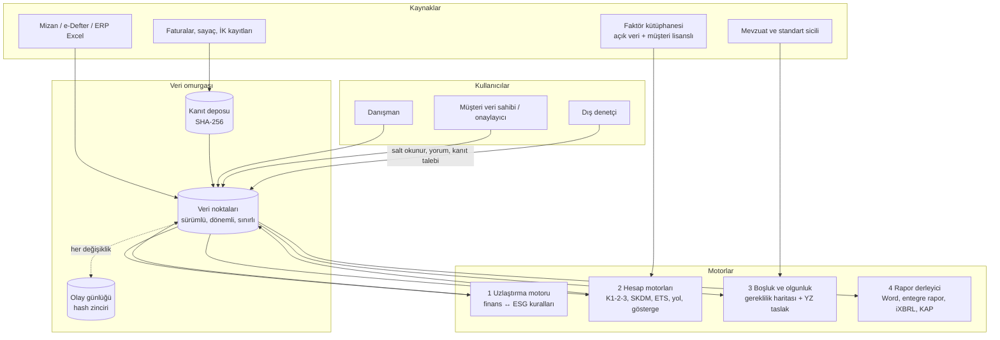
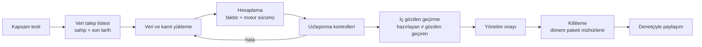
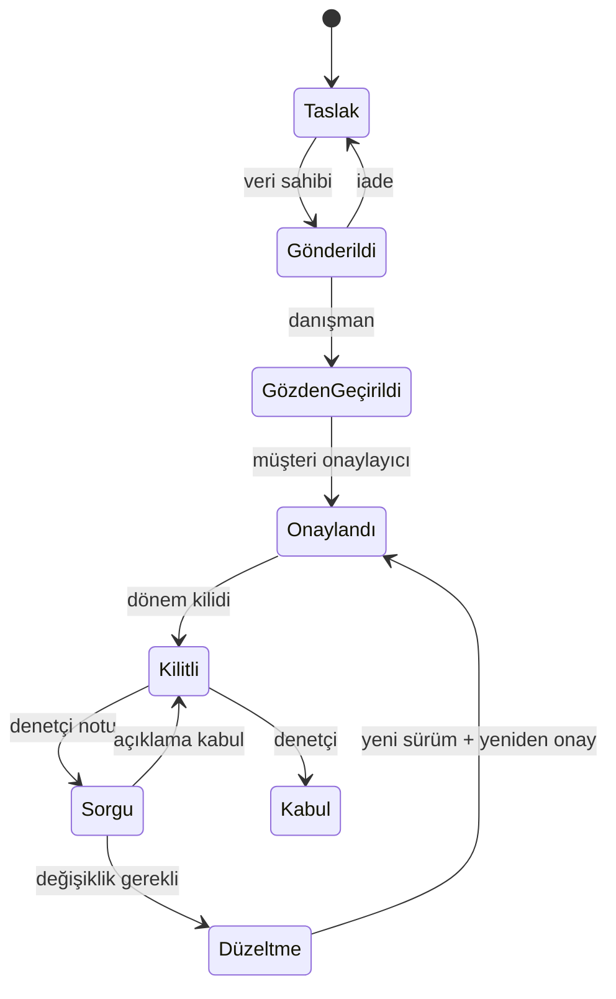

# Isoline hedef mimari: denetime hazır raporlama platformu

> Durum: tasarım kararı taslağı (17.10.2026). Bugünkü sürüm (v0.1) tarayıcıda çalışan bir araç seti; bu belge onun **çok kullanıcılı, kanıta bağlı, denetçiye açık** bir platforma nasıl büyüyeceğini tanımlar.

## 1. Tek cümlelik tez

Isoline, bir şirketin **finansal muhasebesini** (mizan, gelir tablosu, yatırımlar) ve **karbon/sosyal muhasebesini** (emisyon, enerji, işgücü) aynı veri omurgasında birleştirir. Her sayıyı kaynağına, hesabına ve kanıtına bağlar. Bağımsız denetçinin önüne **onaya hazır, izlenebilir bir paket** koyar.

**Isoline denetim yapmaz, denetime hazırlar.** Türkiye'de sürdürülebilirlik güvence denetimini yalnız KGK yetkili kuruluşlar yapabilir. Ürün dili, sözleşme ve arayüz bu sınırı korur: "onaylandı" yerine "denetime hazır" denir.

## 2. Gelen önerinin değerlendirmesi

| Öneri | Karar | Gerekçe ve düzeltme |
|---|---|---|
| A. Finans–ESG çapraz kontrol | **Alınıyor** | Kontroller **belirlenimci kurallar** olarak yazılır (bkz. §4.2). Yapay zekâ yalnız anlatı ile sayı arasındaki çelişkiyi *önerir*; denetçiye uyarıyı kural motoru üretir. Her kural test edilebilir ve aynı veride hep aynı sonucu verir. |
| A. Entegre faaliyet raporu | **Alınıyor** | Entegre Raporlama Çerçevesi (IFRS Vakfı) + TTK asgari içerik + SPK II-14.1 tek şablonda. Mevcut şablon kütüphanesine "entegre rapor" eklenir. |
| B. Kanıtın kriptografik mühürlenmesi | **Alınıyor, sade biçimde** | Her kanıt dosyasının **SHA-256 özeti** saklanır. Her değişiklik, bir öncekinin özetini içeren **değiştirilemez olay günlüğüne** yazılır (hash zinciri). Blokzincir gerekmez: denetçinin istediği "bu sayı bu belgeden, şu tarihte, şu kişi tarafından" izi böyle kurulur. IoT/sayaç verisi sonraki fazda API ile gelir. |
| B. Denetçi arayüzü | **Alınıyor** | Dış denetçi **salt okunur + yorum + kanıt talebi** yetkisiyle girer. Kanıtlar düzenli klasörde, her sayının soy ağacıyla birlikte görünür. |
| C. Yapay zekâ ile mevzuat boşluk analizi | **Değiştirilerek alınıyor** | Eksikleri **kural motoru** bulur: "TSRS 2 ¶22 senaryo analizi için veri yok". Bunu gereklilik haritası ve kapsam testi besler. Yapay zekâ sektöre uygun **taslak açıklama** yazar, kaynak gösterir, kaynak yoksa "kanıt yetersiz" der. "Denetimden geçemezsiniz" gibi hukuki hükmü yapay zekâ vermez; karar uzmanda kalır. |
| ISSA 5000 iş akışı | **Alınıyor, iki standarda eşlenebilir** | IAASB ISSA 5000 (Kasım 2024), 15.12.2026 ve sonrasında başlayan dönemler için yürürlüğe giriyor. Türkiye'de KGK'nın SGDS 5000 uyarlamasının yayımlandığı **doğrulanamadı**; o çıkana kadar GDS 3000 ve GDS 3410 uygulanıyor. İş akışı adımları her iki çerçeveye eşlenir (bkz. §5). |
| XBRL / iXBRL | **Evet, aşamalı** | §7'de. |

## 3. Katmanlar

**Bugünden taşınanlar:**
- Hesap motorları (`web/src/lib/calc/*`) aynı paket olarak hem tarayıcıda hem sunucuda çalışır. Denetçi aynı girdi ve motor sürümüyle aynı sonucu yeniden üretebilir.
- Kaynak sicili (`sources.ts`) gereklilik haritasının çekirdeği olur.
- Çerçeve eşleme (crosswalk) veri noktası tanımlarına dönüşür.
- Kapsam testi, hangi gerekliliklerin devreye gireceğini belirler.

## 4. Dört motor

### 4.1 Veri omurgası: "veri noktası" her şeyin birimi

Rapordaki her sayı bir **veri noktası değeri**dir ve şunları taşır:

| Alan | Örnek |
|---|---|
| Tanım | "Kapsam 1 emisyonları"; eşlemeler: TSRS 2 ¶29(a)(i)(1), GRI 305-1, ESRS E1-6 |
| Bağlam | Şirket, tesis, dönem (2026), sınır (operasyonel kontrol), birim (tCO₂e) |
| Değer ve kaynak | Elle girildi / içe aktarıldı / hesaplandı (hesap çalıştırmasına bağlantı) |
| Yöntem | Kullanılan faktör seti ve sürümü, motor sürümü, girdi özeti |
| Kanıt | Bağlı belgeler (fatura, sayaç dökümü, tedarikçi beyanı) ve özetleri |
| Kalite | Ölçüm / hesaplanmış / tahmini |
| Durum | Taslak → gönderildi → gözden geçirildi → onaylandı → kilitlendi → (denetçi) kabul / sorgu |
| Sürüm | Her değişiklik yeni sürüm; eskisi silinmez |

### 4.2 Uzlaştırma motoru: finans ↔ ESG kuralları

Kurallar katalog hâlinde tutulur. Her kuralın kimliği, açıklaması, toleransı, ciddiyeti ve dayanağı olur. İlk set, bugünkü araçların verisiyle hemen yazılabilir. U1–U5 ve U8–U10, 18.10.2026'da tarayıcıda v1 olarak çalışıyor (`web/src/lib/reconcile.ts`); U6–U7 mizan içe aktarmasını bekliyor:

| # | Kural | Neyi yakalar |
|---|---|---|
| U1 | Faaliyet raporundaki net satış = envanterdeki yoğunluk paydası = taksonomi ciro toplamı | Aynı ciroyu üç yerde farklı yazmak |
| U2 | Enerji göstergesi (GJ) ≥ yakıt enerjisi + elektrik × 3,6 | Enerji toplamının eksik bildirilmesi |
| U3 | İSG/İK çalışan sayısı ≈ kapsam testi ve faaliyet raporu personel sayısı | Farklı çalışan sayıları |
| U4 | SKDM ihracat tonu ≤ üretim tonu | Fiziksel olarak imkânsız ihracat |
| U5 | TR ETS tesis emisyonu ≤ şirket Kapsam 1 | Tesis ve şirket sınırı çelişkisi |
| U6 | Taksonomi uyumlu CapEx'te yatırım var (ör. elektrik ark ocağı) → dekarbonizasyon önlemlerinde karşılığı ve beklenen azaltım var | Önerideki "5 milyon TL makine harcaması" örneği: yatırım var, etkisi planda yok |
| U7 | Faaliyet raporunda yatırım kalemi var → ilgili tesisin enerji/emisyon verisinde değişim ya da açıklama var | Aynı örnek, ters yönden |
| U8 | Önceki yıla göre %±20'yi aşan değişim → açıklama zorunlu | Açıklanmamış sıçramalar |
| U9 | Tahmini veri payı > %X → uyarı | Denetçinin ilk bakacağı risk |
| U10 | Yeşil iddia denetimi: rapor metnindeki "karbon nötr" vb. ifadeler | Tüketici direktifi riski |

Her kuralın sonucu da bir kayıttır (geçti / uyarı / hata + açıklama), denetçi paketine girer.

### 4.3 Boşluk ve olgunluk motoru

- **Gereklilik haritası:** Kapsam testi sonucu → geçerli çerçeveler (TSRS, ESRS, GRI, SPK) → paragraf düzeyinde açıklama gereklilikleri → her biri için "veri var mı, kanıt var mı, metin var mı".
- **Olgunluk puanı:** Gereklilik başına karşılanma oranı, tahmini veri payı, kanıtı eksik sayı adedi.
- **Yapay zekâ rolü:** Eksik metin için sektöre uygun **taslak** yazar, yalnız sistemdeki veri ve kanıtlara atıf yapar, kaynak yoksa "kanıt yetersiz" der. Taslak insan onayı olmadan rapora girmez. Model, istem ve çıktı kayda alınır.

### 4.4 Rapor derleyici

- Sürdürülebilirlik raporu (TSRS, GRI, ESRS), faaliyet raporu (TTK, SPK) ve entegre rapor aynı veri noktalarından üretilir. Bir sayı değişirse her raporda değişir; Workiva'nın güçlü yanı budur.
- Çıktılar: Word paketi, grafik veri setleri, iXBRL, KAP bildirim ön kontrolü.

## 5. İş akışı

### 5.1 Hazırlık (danışman ve müşteri)

### 5.2 Güvence (dış denetçi): ISSA 5000 / GDS 3000 adımlarına eşleme

| Denetçi adımı (ISSA 5000 mantığı) | Isoline'da karşılığı |
|---|---|
| Kabul ve devam, bağımsızlık | Denetim kaydı: denetçi kuruluşu, ekip, kapsam, güvence düzeyi (sınırlı/makul) |
| Planlama ve önemlilik | Kapsamdaki veri noktaları, önemlilik eşiği alanı |
| Risk değerlendirme | Sistemden hazır sinyaller: tahmini veri payı, uzlaştırma uyarıları, büyük değişimler, elle düzeltilmiş hesaplar |
| Kanıt toplama ve örneklem | Kanıt talep listesi (PBC); örneklem seçimi; her örnek için belge, özet, olay günlüğü |
| Bulgular ve düzeltme | Veri noktasına bağlı denetçi notu → müşteri düzeltmesi → yeni sürüm. Eski sürüm görünür kalır. |
| Sonuç ve rapor | Güvence raporu Isoline dışında imzalanır; Isoline yalnız yüklenen raporu ve kapsamını kaydeder |

### 5.3 Veri noktası durum makinesi

Tek kullanıcılı sürümde (Faz 3 öncesi) bu makinenin sade çekirdeği kullanılır: Taslak → Kontrolde → Onaylandı (kilitli) → Yayımlandı. Eşleme ve gerekçe: [DENETIM_RAPORLAMA_2026-10.md §2.3](DENETIM_RAPORLAMA_2026-10.md).

## 6. Roller

| Rol | Görür | Değiştirir | Onaylar |
|---|---|---|---|
| Danışmanlık yöneticisi (kiracı) | Tüm müşterileri | Ayarlar, şablonlar, faktör setleri | — |
| Danışman / uzman | Atandığı müşteriler | Veri, hesap, metin | Gözden geçirme |
| Müşteri veri sahibi | Kendi talepleri | Kendi verisi ve kanıtı | — |
| Müşteri onaylayıcı (CFO / sürdürülebilirlik müdürü) | Kendi şirketi | — | Yönetim onayı, kilit |
| Dış denetçi | Kilitli paket | Yalnız not ve kanıt talebi | Denetçi kabulü (kayıt) |
| Tasarım ajansı | Onaylı içerik paketi | — | — |

Görevler ayrılır: hazırlayan kendi verisini onaylayamaz.

## 7. XBRL / iXBRL

| Yön | Ne | Durum |
|---|---|---|
| İçe | **Mizan**: önce muhasebe yazılımından Excel/CSV; ardından **e-Defter (GİB, XBRL-GL tabanlı)** dosyalarından hesap bakiyeleri | Excel hemen; e-Defter biçim ayrıntısı birincil kaynaktan teyit edilecek |
| İçe | KAP finansal tablo XBRL'i (halka açık şirketler) | Taksonomi ve erişim yolu doğrulanacak |
| Dışa | **ESRS XBRL**: EFRAG taslak taksonomisi 17.09.2026'da yayımlandı, nihai sürüm 2026 sonunda bekleniyor. Etiketleme henüz zorunlu değil. | "Hazırlık modu": iXBRL önizleme ve doğrulama |
| Dışa | TSRS için KAP bildirimi | KAP'ın TSRS bildirim tipi ve şablonu izlenecek |

Mizan içe aktarma, finans–ESG uzlaştırmasının (U1, U6, U7) ön koşuludur; bu yüzden XBRL işinin ilk adımı odur. Excel/CSV mizan içe aktarma 18.10.2026'da tarayıcıda çalışıyor (`web/src/lib/trial-balance.ts`, `spreadsheet.ts`); net satışlar U1'e bağlı. CapEx tek bir mizandan güvenilir çıkmadığı için U6–U7, sabit kıymet hareket tablosu içe aktarmasıyla gelecek.

## 8. Teknik mimari

| Katman | Seçim | Neden |
|---|---|---|
| Arayüz | Next.js 16 + React 19 (bugünkü uygulama) | Değişmez; ekranlar sunucu verisine bağlanır |
| Hesap | `@isoline/calc` paylaşılan TypeScript paketi (bugünkü `lib/calc`) | Tarayıcı ve sunucu aynı sonucu verir; motor sürümü kayda girer |
| API | Next.js route handler'ları + OpenAPI sözleşmesi | Tek dağıtım; sözleşme test edilebilir |
| Veritabanı | PostgreSQL 18 + satır düzeyi güvenlik (RLS) | Kiracı izolasyonu veritabanı seviyesinde |
| Kanıt deposu | S3 uyumlu nesne deposu: yerelde MinIO, bulutta Cloudflare R2 | Çevrim dışı öncelik: kurum içi kurulum mümkün |
| Arka plan işleri | pg-boss | Özet alma, OCR, yapay zekâ, XBRL dönüşümü |
| Olay günlüğü | Yalnız ekleme yapılan tablo; her satır bir öncekinin SHA-256 özetini içerir | Değiştirilemezlik kanıtı |
| Yapay zekâ | Sağlayıcıdan bağımsız geçit (varsayılan Claude); kaynak zorunlu; müşteri verisi eğitimde kullanılmaz | Kaynaksız metin üretimi kapalı |
| Dış erişim | Kurum içi kurulumda Cloudflare Tunnel | Yerel ağda izole, gerektiğinde dışa açık |

Bu yapı, MavenPlatform v3'te kurulan desene (PG18 + RLS + OpenAPI + pg-boss) bilerek benzetildi; aynı operasyon bilgisi kullanılır.

## 9. Yeniden fazlanmış yol haritası

Her faz bir kontrol noktasıyla biter.

| Faz | Kapsam | Kontrol noktası |
|---|---|---|
| **2 — Veri doğruluğu** (sürüyor) | Faktör kütüphanesi + kendi faktörünü getir; resmi SKDM varsayılan tablosu; **uzlaştırma kuralları v1 (U1–U5, U8–U10) tarayıcıda**; **mizan içe aktarma (Excel)** | 3 anonim müşteri verisiyle kural sonuçlarının uzmanca doğrulanması |
| **3 — Platform çekirdeği** | Kimlik doğrulama, kiracı/müşteri/rol modeli, PostgreSQL + RLS, veri noktası sicili, sürümleme, kanıt deposu + SHA-256, olay günlüğü | İzolasyon testi (iki kiracı, sıfır sızıntı); olay günlüğü bütünlük testi |
| **4 — Denetime hazır paket** | Veri noktası durum makinesi, onay ve kilit, PBC listesi, **denetçi çalışma alanı** (salt okunur, not, örneklem), dönem paketi dışa aktarımı | Bir güvence kuruluşuyla deneme denetimi |
| **5 — Boşluk analizi ve yapay zekâ** | Gereklilik haritası (TSRS, ESRS, SPK), olgunluk puanı, kaynaklı taslak yazımı, U6–U7 (yatırım ↔ etki) | Yapay zekâ önerilerinin %100'ünde kaynak ya da "kanıt yetersiz" ibaresi |
| **6 — Entegre rapor ve dijital çıktı** | Entegre rapor şablonu, ESRS iXBRL, e-Defter (XBRL-GL) içe aktarma, KAP ön kontrolü | Bir pilot müşteriyle uçtan uca raporlama döngüsü |

## 10. Açık kararlar

1. **Barındırma:** Kurum içi kurulum (çevrim dışı öncelik, MinIO) mı, bulut mu, ya da ikisi birden mi? Bu karar KVKK, veri yerleşimi ve satış modeli açısından önemli.
2. **Denetçi tarafı ticari modeli:** Denetim kuruluşları misafir olarak mı girer, yoksa onlara da lisans satılır mı?
3. **Yapay zekâ ve müşteri verisi:** Müşteri belgeleri dış model sağlayıcısına gönderilebilir mi (müşteri onayıyla), yoksa yalnız kurum içi model mi kullanılır?
4. **Mizan biçimi:** İlk pilot müşterilerin muhasebe yazılımı (Logo, Mikro, Netsis, SAP…) hangisi? İçe aktarma şablonu buna göre önceliklendirilir.
