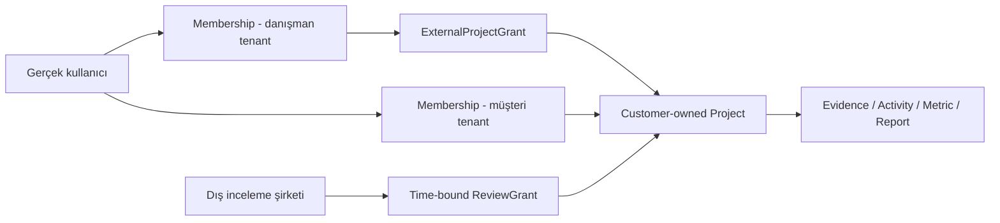

# 03 — Tenant modeli, kurumsal veri sahipliği, dış erişim ve yetki

## 1. Nihai tenant kararı

**Tenant = sınırlandırılmış veri/işlemler, üyelik, audit, faturalama ve saklama politikası olan kurumsal çalışma alanı**; `Organization` ise raporlanan gerçek şirket/holding/tüzel kişilik grubu olabilir. Bunlar aynı kelime değildir. Önerilen SaaS modeli: **shared PostgreSQL / shared schema / tenant_id on all business tables + RLS + application policy engine**. Tesisler/bağlı ortaklıklar **ayrı tenant olmak zorunda değildir**; reporting entity hiyerarşisinde tutulur. Gerçek ortaklık veri paylaşımı önceden kararlaştırılmışsa sonradan birden fazla tenant düzeyinde proje ilişkisi açılabilir.

- `TENANT_KIND = company | advisory | partner`: ilk rolü belirtir, tek başına erişim belirlemez.
- **Müşteri verisinin ownerTenantId'si müşteri workspace'idir.** Danışman müşteri tenant'ında `ExternalProjectGrant` alır; kendi portföyünde grant sayesinde iş özetini görür.
- Danışman hesabı firma çalışanlarının üyeliğini ve kendi müşteri listesi görünümünü tutar; **müşteri verisini genel danışman tablosuna kopyalamaz**.
- Müşteri kendi raporuna danışman atayabilir; danışman müşteri adına geçici kayıt oluşturup yetkiliye devredebilir.
- Danışmanın bağımsız hazırlık notları ile raporlanacak müşteriye ait veri/lisanslı içerik ayrı sahiplik ve saklama kurallarına tabidir.

## 2. Güven sınırlarının ayrılması

**Raporlanan holding** `CorporateGroup` içinde çoklu `LegalEntity/Facility` barındırır; `OwnershipEdge(valid_from, valid_to, percentage, control_type)` tarihli olur. Projenin kendi `ReportingBoundary` seçimi vardır; basit organizasyon ağacının üstüne raporlama sınırı bindirilir.

## 3. Kimlik / üyelik / proje yetki bileşenleri

| Nesne | Zorunlu alanlar ve davranış |
|---|---|
| `Identity` | canonical user UUID, email verified, OIDC subject, status, MFA durumu; tek kişi birden fazla tenant üyesi olabilir |
| `Tenant` | legal owner/host entity, data region, lifecycle, terms/policy version |
| `TenantMembership` | user_id, tenant_id, role, scope, invited_by, accepted_at, revoked_at; unique active membership |
| `TenantInvitation` | token hash, email, inviter, expiry, intended role, intended tenant; bir kez kullanım |
| `ExternalProjectGrant` | customer_tenant_id, advisory_tenant_id, engagement_id/project_id, role list, data scopes, expires_at, consent_id, revoked_at |
| `ProjectParticipation` | user and/or external organization, project, role and delegated scope; grant olmadan dış kullanıcıya doğrudan yetki yok |
| `AccessPolicy` | effect, resource family, action, scope conditions, policy_version; deny-by-default |
| `ReviewGrant` | özet veya belirli kanıt/snapshot üzerinde salt okuma + yorum; zamanlı ve indirilebilme bayraklı |
| `ConsentRecord` | müşteri sahibinin hangi projeyi, amaç ve verileri, kimlere açtığı, izin versiyonu |
| `Session` | device info, refresh token rotation, revokeAll, idle timeout, membership switching |
| `AuditEvent` | actorUser, actingTenant, ownerTenant, project, action, before/after digest, IP/client meta (saklama politikası), time |

## 4. İlk giriş / onboarding yolları

### Yol A — Yeni şirket kendi raporunu üretiyor

`/auth/signup` → e-posta doğrulama → kullanıcı profili → `Şirket olarak başla` → tüzel kurum adı/ülke/vergi tanımlayıcı isteğe bağlı/uygun şartlar → `company tenant` → şirket yöneticisi ve ilk çalışma alanı → işletme ağacı → ilk proje/standart/dönem → ekibe davet → veri kampanyası.

### Yol B — Yeni danışmanlık firması

`/auth/signup` → `Danışmanlık firması` → advisory tenant → ekip + davet/rol → `Müşteri ekle` → mevcut müşteri tenant daveti **veya geçici müşteriyi oluşturma** → hizmet yetki sözleşmesi → proje → data owner istekleri.

### Yol C — Müşteri bağımsız danışman istiyor

Şirket projesi → `Dış ekip davet et` → kuruluşu bul (dizin doğrulanmışsa) veya kurumsal e-posta → rol `hazırlama / gözden geçirme / metodoloji danışma / tasarım / güvence hazırlık` → proje/dönem/tesis/belge kapsamı → süre/indirme hakkı → özet ve paylaşım onayı → davet kabul → ayrık `Consultancy View`.

### Yol D — Danışman müşteriye ilk kez hesap açıyor

Advisory tenant → `Yeni proje / Davet edilecek müşteri` → müşteri/kurum kaydı `provisional` → asgari bilgiler → yetkili müşteri e-posta daveti → müşteri temsilcisi verify/claim → veri sahibi/mülkiyet şartlarının onayı → `owned_by_customer=true`. **Claim olmadan yazılan değerler geçici, yayımlanamaz** politikası önerilir.

### Yol E — Harici gözden geçirme/güvence

E-posta daveti → doğrula → koşulları kabul et → kısa erişim/aktif proje/dönem/belge görünümü → bulgu ve belge talebi → raporlama ekibinin cevapları → review kapanışı; kurum yönetişim imzası veya resmî bağımsız denetim raporu yetkisi otomatik verilmez.

## 5. Kimlik ve üye yönetimi ekranları

1. Giriş, kayıt, e-posta doğrulama, SSO/OIDC seçimi, MFA enrollment, TOTP/recovery, şifre sıfırlama veya passkey hazırlığı, oturum kapatma.
2. Birden fazla kuruma üye olunduğunda tenant seçimi; aktif tenant/proje context bar; mevcut proje seçici.
3. `Kurumumu Oluştur` formu; üyeliğe davet; davet kabul/red, süresi dolmuş/kullanılmış davet.
4. Kurum profili/veri sorumlusu/dil/yerel saat/ülke; ekip üyeleri/roller; harici kuruluş ilişkileri.
5. Danışman müşteri portföyü, erişim sözleşmesi, erişim süresi uzatma, grant iptali.
6. Müşteri şirketinin danışmanlık firmaları listesi ve açık paylaşımların kapsamı.
7. Tüm oturumları iptal, MFA zorunluluğu, erişim ve veri dışa aktarım geçmişi.
8. Veri ihracı, devir, tenant dondurma, retention/legal hold, hesabı kapama (hukuken saklanması gereken veriler korunur).

## 6. RBAC + ABAC (şirket, proje, varlık, iş durumu)

**Rol**, kullanıcının hangi eylemlere aday olduğunu belirler. **ABAC**, hangi müşteri/proje/tesis/belge/sürüm/durum içinde izinli olduğunu kontrol eder. Sunucu her okumada ve mutasyonda iki katmanı da doğrular.

| Rol | Veri oluştur | Veri onayla | Rapor yaz | Yayına al | Kullanıcı/erişim | Harici kanıt |
|---|---|---|---|---|---|---|
| Company owner | Kendi kapsamı | Yetkisine göre | Evet | Son yönetim rolüyle | Kendi tenant | Politika dahilinde |
| Project lead | Evet | Yetkiye ve görev ayrımına göre | Evet | Tek başına hayır | Proje daveti önerir | Proje kapsamında |
| Facility contributor | Kendi görevlerinde | Hayır | Hayır | Hayır | Hayır | Kendi yükledikleri |
| Data owner/reviewer | İlgili alan | Başka kişinin verisi | Yorum | Hayır | Hayır | İlgili kaynak |
| Advisory preparer | İzinli proje | Müşteri yönetim imzası veremez | Evet | Hayır | Danışman ekibi | Grant kapsamı |
| Advisory reviewer | İnceleme notu | Şirket adına nihai onay veremez | Öneri/düzeltme | Hayır | Hayır | Dar izin |
| Report editor | Veri yazmaz | Hayır | Evet | Hayır | Hayır | Onaylı facts |
| Management signer | Rapor/ek karar | Son imza | Yorum | Evet | Hayır | Gerektiği kadar |
| External assurance reviewer | Veri değiştirmez | İşletme onayı veremez | Bulgu/talep | Hayır | Hayır | Time-bound read |
| Design partner | Yalnız asset paketi | Hayır | Prova yorumu | Hayır | Hayır | Ham hassas kaynak yok |
| Supplier contributor | Kendi cevapları | Hayır | Hayır | Hayır | Hayır | Yalnız kendi kanıtı |

**Görev ayrımı:** Hazırlayan `user_id` = onaylayan `user_id` ise işlem reddedilir; isim yazısı eşitsizliği yeterli değildir. `reopen` gerekçeli yeni sürüm üretir. Harici kullanıcı başka kurum onayına impersonate edemez.

## 7. Harici yetki güvenlik kuralları

- Cross-tenant listeleme yalnız `grant + user membership + project participation` ile. Tenant ID'yi URL değiştirerek erişim mümkün olmaz.
- Her grants tablosunda `revoked_at`, `expires_at`, `purpose`, `scope_json` ve `data_classes` kayıtlı.
- Daraltıcı erişimler için belge bazlı allowlist; dosya indirme presigned URL kısa ömürlü; indirme olay günlüğü.
- Yeni hizmet ortağına “proje yönetimi” izni, müşteri **yasal veri sahipliği** devri anlamına gelmez.
- Kullanıcı kurum değiştirdiğinde tenant bazlı API cache/notification/RSC cache temizlenir. Sunucu cache key her zaman ownerTenant+project+role+version içerir.
- Sistem yöneticisi müşteri verisine normal işletim gerekçesiyle otomatik erişemez; break-glass ayrı denetlenir.

## 8. Veri kontrolcüsü / işleyici sorumluluğu

Sözleşmelere ve gerçekte kimin amacı/vasıtayı belirlediğine göre KVKK/GDPR veri sorumlusu-veri işleyen rolleri **olay bazında** hukuk ekibiyle kararlaştırılmalıdır; uygulamada “müşteri tenant sahibi” olması hukukî rolü otomatik belirlemez. Gereksiz çalışan kişisel verileri saklamayın; insan kaynakları göstergeleri agregat olsun. Veri aktarım lokasyonu, kanıtın elde tutulması, erişim izni, saklama ve veri ihlali süreçleri sistem özelliğidir.

## 9. Mimari kabul senaryoları

- Danışman A, müşteri X ile Y'yi aynı portföyde görür; X görev kaydı Y API ID'siyle okunamaz/yazılamaz.
- Müşteri Y danışman A'yı iptal eder; A'nın bağlı kullanıcıları ve aktif dosya linkleri ilk sonraki istekte kapanır; rapor geçmişi Y'de kalır.
- Müşteri iki ayrı danışmana aynı raporda “metin” ve “gözden geçirme” grant verir; biri diğerinin gizli notlarını otomatik göremez.
- Harici incelemeci 2026 Scope 2 kanıtını görür; 2025 bordro belgesini, aynı şirkette olsa bile göremez.
- Kullanıcı X hem danışman hem müşteri üyesiyse ekran doğru **acting tenant + data owner tenant + project context** gösterir ve işlemi audit'e bu bağlamla yazar.
