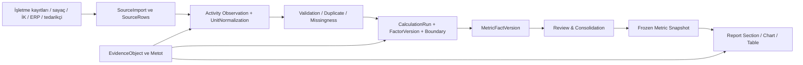

# 09 — Hesap motorları, kaynak veri, kanıt, kalite ve konsolidasyon

## 1. Tek veri omurgası (source → result → disclosure)



Her yayımlanan grafik/sayı `{fact_version_id, unit, reporting_period, reporting_boundary, method, source_refs, review_state}` taşır. İki rapor aynı değeri kullanabilir ama yalnız **kapsam+dönem+birim+metod aynı** ise birebir yeniden kullanabilir. “Sayıyı bir kere gir” işlemi aynı değeri farklı bağlamda yeniden hesaplamadan sunmak anlamına gelmez.

## 2. Veri kaynakları ve içe aktarma

| Kanal | İstenen işlev | Kritik hata kontrolü |
|---|---|---|
| Elle giriş | Alan, ölçü birimi, zaman, kaynak metodu, tesis | negatif/boş/sıfır ayrımı, yetki |
| CSV/XLSX/ODS | Sihirbaz, sheet/header bulma, kolon/birim/map önizleme | tarih/birim hatası, mükerrer işlem |
| PDF/belge | Güvenli saklama, kanıt dosyası, metadata | PDF'den otomatik sayı çıkarmak zorunlu değil, sonuç manuel doğrulanır |
| ERP/Finans | Mizan, hesap planı, konsolide tablolara referans | borç/alacak ve konsolidasyon kontrolü |
| Sayaç/Enerji | Tesis/asset/meter/time-series | sayaç reset, tahmini okuma, fiziksel birim |
| İnsan kaynakları | Toplulaştırılmış kişisel olmayan sonuçlar | gizlilik, dönem, personel sayım tanımı |
| Tedarikçi | Portal, form sürümü, sözleşme/kanıt | kapsamlı izin, factor methodology, tekrar talep |
| API/integration | Pull/push, rate limit, run log, retry | tüm mutasyonlar idempotent ve auth kontrollü |

**Import işlemi:** `UPLOADED` → `SCANNED` → `PREVIEWED` → `MAPPED` → `VALIDATED` → `COMMITTED` → `OBSERVATIONS_CREATED`. `COMMITTED` işlemi transaction; satır bazlı hata listesi, kısmi kabul politikası ve rollback manifestosu zorunlu. Kaynağın ham dosyası/CSV versiyonu değişmeden saklanır.

## 3. Birim, kapsam ve zaman normalizasyonu

- **Birim tipleri:** mass, volume, energy, distance, activity, people, rate, money; SI/kurallı dönüşüm, referans yılı/tarih, güvenli yuvarlama.
- **Ay/yıl:** monthly flow (`SUM`) ile year-end balance (`LAST`) asla aynı aggregator'da değil. Headcount/ortalama çalışan sayılarını kayıt türüne göre hesapla.
- **Para birimi:** finansal veri `currency`, `fx_rate_type`, `fx_rate_date`, original/functional/reporting currency; kesin finansal metrikler hesap motorundan bağımsız kontrollü.
- **Emisyon:** fiziki `activity × factor` (gerekirse alt bileşenler), Scope 2 location/market based ayrı; tCO₂e yöntem ve GWP versiyonu.
- **Ürün:** ton ürün, proses rotası, satır/ham madde/öncül, geçerli birim ve kalite; CBAM hukukî ürün tanımlaması ayrı.

## 4. Faktör sicili ve lisans

`FactorSet`, `FactorValue`, `source`, `publisher`, `published_at`, `effective_period`, `geography`, `technology`, `unit_numerator`, `unit_denominator`, `gas`, `GWP_version`, `methodology_version`, `license/redistribution`, `verified_at`, `sha256`. Eski hesaplar eski faktör `id`'yi referans eder. Yeni değer yayımlandığında risk analizi ve isteğe bağlı **controlled re-run** yapılır; yayımlanmış rapor sessizce değişmez.

**Kaynak dereceleri:** resmî yıllık bölgesel katsayı; lisanslı veri; tedarikçi birincil veri; şirket spesifik; proxy/ortalama. Kaynak hiyerarşisi her metrikte metodolojiyle uyumlu seçilir; “en yeni” katsayı “o rapor yılı için doğru” demek değildir.

## 5. Hesap çalıştırması teknik kontrat

```json
{
  "projectId":"<uuid>", "reportingCycleId":"<uuid>",
  "boundaryVersionId":"<uuid>","facilityId":"<uuid-or-null>",
  "metricDefinitionId":"GHG_SCOPE2_LOCATION_TCO2E",
  "inputs":[{"observationVersionId":"<uuid>","unit":"kWh"}],
  "methodVersion":"ghg-s2-vX", "factorVersionId":"<uuid>",
  "engineCommit":"git-sha", "runMode":"preview",
  "result":{"value":"1234.567890","unit":"tCO2e"},
  "inputDigest":"sha256", "outputDigest":"sha256"
}
```

Örnek değerler **gerçek ürün API'si değil hedef sözleşmedir**. Node/TypeScript tarafında JS `number` ile hatasız finansal konsolidasyon varsayılmamalı; alan bazında Decimal/rasyonel aritmetik, ölçü toleransı ve yuvarlama testleri yapılır. Mevcut hesap motorları property-based testlerle sonuç parity sağlayarak sunucu katmanına taşınır.

## 6. Kanıt ve veri kökeni

- Kanıtın aslı object storage'da; metadata PostgreSQL'de. `EvidenceObject` > `EvidenceLink` aracılığıyla ObservationVersion, CalculationRun, MetricFactVersion, Disclosure veya ReportSectionVersion'a bağlanabilir.
- Fatura PDF'si **tüm** açıklamalar için zorunlu değildir: metrik bazlı `EvidencePolicy`: `required_kind`, `accepts_estimate`, `approver`, `risk_class`, `retention`, `confidentiality`.
- Kaynak yoksa `evidence_missing` açık. Sadece belge adı + SHA-256 olan legacy kayıtlar `legacy-metadata-only`; dosya aslı yoksa reviewer dosyayı açmış gibi gösterilmez.
- AI ile doküman sınıflandırma/alan önerisi ileride olabilir; otomatik çıkarımı bir insan veya yüksek güvenli doğrulama kuralı kabul etmeden gerçek onaylı değere yükseltme.

## 7. Kalite motoru (kural grupları)

| Grup | Örnek kural | Hata/uyarı ilkesi |
|---|---|---|
| Şema | beklenen birim/alan dolu, zaman geçerli | `blocker` |
| Tutarlılık | aynı sayaç aralıkları çakışmıyor | `blocker` |
| Eşik/aritmetik | Scope 1 alt kalemleri uyumlu | `blocker` veya uzman kontrolü |
| Zaman serisi | geçen aya göre beklenmeyen büyük değişim | `warning`, anomali açıklaması |
| Kanıt | kaynak belgesi / hesap yöntemi eksik | policy'ye göre blocker |
| Kaynak | emisyon faktörü geçerlilik yılı uyuşmuyor | `blocker` |
| Finans | rapor net satış ile mizan net satış uyumsuz | toleransa göre `blocker` |
| Konsolidasyon | tesis toplamı vs grup toplamı açıklanmıyor | `blocker` |
| Disclosure | zorunlu standart açıklaması eksik | review gate blocker |
| Yeşil iddia | kanıtlanmamış genel/yüzde iddia | editoryal uyarı ve hukukî review |

Kontrol motoru deterministik (aynı veri, aynı sürüm → aynı sonuç); LLM en fazla açıklama/inceleme taslağı önerir. Her kontrolün `rule_version`, `observed`, `expected`, `tolerance`, `severity`, `source`, `owner`, `resolution` alanı bulunur.

## 8. Finansal ve çevresel konsolidasyon ayrımı

**Kurumsal sera gazı envanteri** için GHG Protocol organisatorik sınır (özkaynak payı, finansal kontrol veya operasyonel kontrol) ve operasyonel sınır; **finansal konsolidasyon** için ilgili IFRS/TFRS, bağlı ortaklıkları, müşterek kontrol ve grup içi eliminasyonları ayrı işleme tabi. AB CBAM için **tesise ve üretim prosesine özgü** başka sınır vardır. Üç ayrı `BoundaryKind` ve `ConsolidationRuleSet`.

**Cihaz/meter ilişkisi:** aynı tesisin sayaçları tenant için ortak varlık olabilir; rapor cycle boundary ile hangi payda rapora girdiği seçilir. 2026 ortasında tesis kontrol değişirse `valid_time` ile hesap bölünür; yıl sonu ağacını tüm yıla uygulama.

**Örnek:** Holding 2026 ilk 6 ay %60, sonraki 6 ay %80 hisse sahibi ama operasyonel kontrol tüm yıl: GHG equity share yıl dilimi bazında hesaplanırken GHG operational control geçerli operasyonel kurala göre olabilir; finansal muhasebe IFRS kontrol kurallarına göre ayrı çalışır. Bunlar “mülkiyet payı × tüm KPI” basitliğine indirgenemez.

## 9. Rapor revizyonu / fact-lock

Onaylanan veri değiştirilmek istendiğinde yeni observation revision → yeni calculation run → yeni metric fact version → önceki fact `superseded` → ilişkili rapor bölümü `stale_reference` → yeniden gözden geçirme → yeni `ReportRelease`. `ReportRelease` hiçbir zaman in-place overwrite edilmez.

## 10. Hedef kabul testleri

1. Birim `MWh/kWh` karıştırınca ön izleme ve hesap kontrolü doğru uyarı veriyor.
2. Aynı elektrik faturası dosyası iki kez eklenirse duplicate uyarısı çıkıyor ve kaynak kayıt sayısı artmıyor.
3. 2025 ve 2026 katsayısı ayrılıyor; 2025 yayımlanmış rakam yeni faktörle otomatik değişmiyor.
4. Operasyonel kontrol ve özkaynak payı kurgusu farklı sonuçları gerekçeli üretiyor; finansal eliminasyonun ayrı işlemi görülebiliyor.
5. Veri kaynağı revoke edilen kullanıcı kanıta tekrar erişemiyor, ama audit kaydı silinmiyor.
6. Tek metrik sonucu API → CSV → SVG grafik → DOCX'e **aynı snapshot ve round precision** ile gidiyor.
